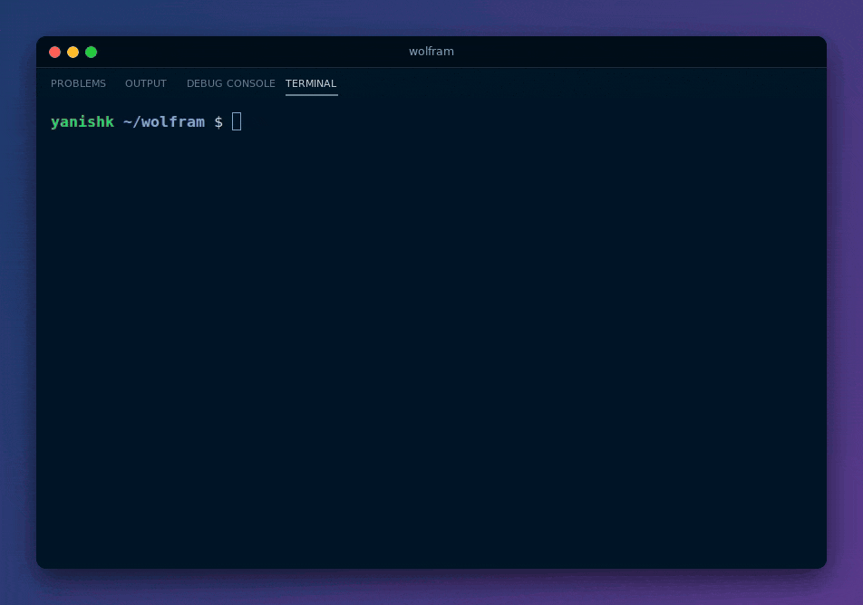
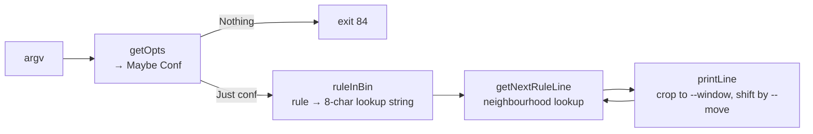

<div align="center">

# Wolfram: elementary cellular automata in Haskell

**All 256 of Wolfram's elementary rules in the terminal, from any starting line, in about 150 lines of pure Haskell.**




[Quick start](#quick-start) · [Options](#options) · [How it works](#how-it-works)

</div>

---

## About

Wolfram is a functional programming project from Epitech's second year. The brief: implement Stephen Wolfram's [elementary cellular automata](https://en.wikipedia.org/wiki/Elementary_cellular_automaton) in Haskell and print each generation as a line of `*` and spaces, with options for the rule, the number of lines, the window and its offset.

Each generation is a row of cells. A cell's next state depends only on itself and its two neighbours, so there are 8 possible neighbourhoods. A rule is an 8-bit number that gives the outcome for each of them, which is why there are exactly 256 rules. Some draw simple triangles, rule 90 draws a Sierpiński triangle, and rule 30 looks random.

## Highlights

- **Every rule, one generic function**: the rule number is turned into an 8-character lookup string once, and a single function applies it. No rule is special-cased.
- **Bonus `--generation`**: start from any first line of `*` and spaces instead of a single live cell.
- **Unbounded field**: the line grows by one cell on each side every generation, so patterns never hit an artificial wall. The `--window` only crops what is displayed.
- **Hand-written option parsing**, no library: pattern matching on the argument list fills a `Conf` record of `Maybe` fields, then every value is validated and any error exits with code 84.

## Quick start

### Prerequisites

[Stack](https://docs.haskellstack.org/) (it downloads the right GHC for the `lts-20.11` resolver on first build).

### Build and run

```bash
git clone https://github.com/yanishk/wolfram.git
cd wolfram
make            # stack build, then copies the binary to ./wolfram
./wolfram --rule 30 --lines 20
./wolfram --rule 110 --lines 25 --move 20
./wolfram --rule 22 --generation "*     *     *" --lines 25
```

`make clean`, `make fclean` and `make re` work as usual.

## Options

| Option | Default | Meaning |
|--------|---------|---------|
| `--rule N` | required | Rule number |
| `--start N` | `0` | Generation at which to start printing (earlier ones are computed but skipped) |
| `--lines N` | infinite | Number of lines to print |
| `--window N` | `80` | Width of the printed window, in characters |
| `--move N` | `0` | Horizontal shift of the window, can be negative |
| `--generation STR` | `"*"` | First line, made of `*` and spaces (bonus) |

Options can come in any order. A missing rule, an unknown flag, a flag without its value, a value that isn't a number, or a negative `--start`, `--lines` or `--window` makes the program exit with code 84.

## How it works



- `ruleInBin` writes the rule in binary, most significant bit first, using `*` for 1 and a space for 0.
- `genericRule` maps each 3-cell neighbourhood, from `***` down to three spaces, to its character in that string. This is the standard Wolfram ordering, so rule 30 here is rule 30 everywhere.
- `getNextRuleLine` pads the current line with two blank cells on each side and slides that 3-cell lookup across it. Each generation is therefore one cell wider on each side than the previous one.
- `printLine` centres the line in the window, crops it to `--window` columns and offsets it by `--move`.

```
app/Main.hs         Entry point: parse, validate, run
app/SetConf.hs      Conf record, option parsing and validation, rule → lookup string
app/PrintRules.hs   Next generation, neighbourhood lookup, windowed printing
```

## Author

Built solo by [**Yanis Harkouk**](https://github.com/yanishk) in February 2024 (14 to 22).

## License

Educational project (Epitech, 2024).
